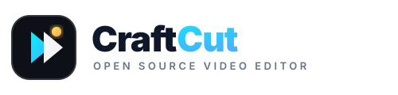

<p align="center">
  <picture>
    <source media="(prefers-color-scheme: dark)" srcset="docs/brand/craftcut-logo-white.svg">
    
  </picture>
</p>

<h1 align="center">CraftCut</h1>

<p align="center">
  <b>Mobile & web video editing, AI smart cutout, vocal isolation and pro motion; an open-source, clean-room reimplementation of CapCut, with all PRO features unlocked completely for free.</b>
</p>

<p align="center">
  An authentic, 1:1 mobile take on the CapCut workflow: native on Android via Capacitor, and on Desktop and Mobile browsers.<br>
  Built with open standards, zero watermarks, and zero paywalls.
</p>

<p align="center">
  <a href="LICENSE"></a>
  
  
  
  
  <a href="#architecture"></a>
</p>

<p align="center">
  <a href="#edit"><b>Edit</b></a> ·
  <a href="#cutout-and-ai"><b>Cutout & AI</b></a> ·
  <a href="#audio-studio"><b>Audio Studio</b></a> ·
  <a href="#effects-and-motion"><b>Effects & Motion</b></a> ·
  <a href="#transitions"><b>Transitions</b></a> ·
  <a href="#opencut-scripting--api"><b>OpenCut Scripting API</b></a> ·
  <a href="#titles-and-captions"><b>Captions</b></a> ·
  <a href="#masks-and-canvas"><b>Masks & Canvas</b></a> ·
  <a href="#export-and-codecs"><b>Export</b></a> ·
  <a href="#android-native"><b>Android</b></a> ·
  <a href="#architecture"><b>Architecture</b></a> ·
  <a href="#get-started"><b>Get Started</b></a> ·
  <a href="#keyboard-shortcuts"><b>Shortcuts</b></a>
</p>

<br>

<p align="center">
  
</p>

<p align="center"><sub><i>CraftCut Mobile Editor</i>: Pure pitch-black canvas (`#000000`), 9:16 vertical player, filmstrip timeline with signature double-dot handles, live microphone voice recorder, AI background removal, vocal isolation, and 4K 60FPS export without subscriptions.</sub></p>

> [!NOTE]
> **CraftCut is a 100% free and open-source project.** All features that require a paid CapCut Pro subscription (such as Smart Cutout, Auto Captions, Vocal Isolation, Audio Denoise, 60 FPS Optical Flow, and 4K Export) are unlocked for everyone forever.

<br>

---

## ⚡ CapCut Pro vs CraftCut

| Feature | CapCut Official | CraftCut (Open Source) |
| :--- | :---: | :---: |
| **Pricing & Subscription** | R$ 40+/month (Paywalled) | **100% Free Forever (MIT)** |
| **Watermark Removal** | Requires login or Pro | **Zero Watermark on All Exports** |
| **Smart Cutout (AI Background Removal)** | 🔒 Pro Only | **✅ Free & Unlocked** |
| **Auto Captions by AI** | 🔒 Pro Limited | **✅ Free & Unlocked** |
| **Vocal Isolation & DSP Denoise** | 🔒 Pro Only | **✅ Free & Unlocked** |
| **Smooth Slow Motion (Optical Flow 60fps)** | 🔒 Pro Only | **✅ Free & Unlocked** |
| **4K 60FPS High-Bitrate Export** | 🔒 Pro Only | **✅ Free & Unlocked** |
| **Camera Stabilization & Anti-Shake** | 🔒 Pro Only | **✅ Free & Unlocked** |
| **Live Microphone Voice Recorder** | Standard | **✅ WebRTC Live Recording Built-in** |
| **Privacy & Data Telemetry** | Cloud Upload / Analytics | **100% Local On-Device Processing** |

<br>

---

## Edit

<p align="center">
  <b>A timeline your hands already know.</b>
</p>

CraftCut faithfully recreates CapCut's iconic mobile timeline ergonomics down to the single pixel:

- **Signature Double-Dot Pill Handles:** When any video clip is tapped or selected, it is outlined in a thick white border with CapCut's trademark white pill drag handles (`handle-left` and `handle-right`) containing twin vertical grip dots for micro-trimming.
- **Dedicated Track Controls:** Fixed left rail with instant **Capa (Cover Preview)** generator and **Silenciar áudio do clipe (Mute Clip Audio)** toggle.
- **Dynamic Two-Level Bottom Navigation:**
  - **Level 1 (Project Overview):** `Editar`, `Áudio`, `Texto`, `Camadas (PIP)`, `Efeitos PRO`, `Filtros`, `Legendas IA PRO`, `Ajustar`, `Stickers`, `Tela (Plano de Fundo)`, `Proporção`.
  - **Level 2 (Active Clip Context):** `< Voltar`, `Dividir`, `Velocidade`, `Animação PRO`, `Recorte IA PRO`, `Volume`, `Filtros`, `Ajustar`, `Máscara`, `Voz PRO`, `Denoise PRO`, `Estabilizar PRO`, `Congelar`, `Girar`, `Espelhar`, `Duplicar`, `Excluir`.
- **Instant Split at Playhead:** Razor-sharp slice right at the current scrubber point (`S` key on desktop, or `Dividir` button on mobile).
- **Freeze Frame (Congelar):** Extracts the exact current frame and inserts a 3-second freeze picture with filmstrip indicator.
- **Add Media Button:** Square rounded `+` button pinned at the tail of the timeline to import photos and videos from your device.
- **Full History Stack:** Unlimited undo and redo operations (`Ctrl+Z` / `Ctrl+Y`) with persistent playback state.

<br>

---

## Cutout and AI

No green screen required. CraftCut unlocks all AI-assisted segmentation tools:

- **Smart Cutout (Remoção Automática):** 1-tap subject extraction with dynamic luma/chroma edge detection that isolates human figures from background scenes.
- **Chroma Key Studio:** Interactive RGB color picker with real-time eyedropper, adjustable intensity threshold (0–100%), shadow softness compensation, and neon border outline effect.
- **Custom Neon Outline:** Adds glowing edge strokes around cutout subjects with selectable cyan, gold, and violet neon palettes.

<br>

---

## Audio Studio

Professional audio tools built on the W3C Web Audio API and WebRTC:

- **Live Microphone Recording:** Integrated voiceover booth using `navigator.mediaDevices.getUserMedia`. Record voiceovers directly over your timeline with countdown and live waveform indicator.
- **Vocal Isolation (Isolamento Vocal PRO):** Advanced digital signal processing (DSP) separating speech from background instrumental tracks.
- **AI Denoise (Redução de Ruído PRO):** High-pass and adaptive noise reduction filtering hum, AC noise, and room reverb.
- **Volume Booster (Até 1000%):** CapCut's signature gain stage allowing up to 10× volume boost with soft-knee limiting to prevent harsh digital clipping.
- **Voice Changer Effects:** Pitch-shifted presets including *Tiozinho (Deep Pitch)*, *Esquilo (Chipmunk)*, *Robô*, *Megaafone*, and *Eco de Estádio*.

<br>

---

## Effects and Motion

Real-time canvas shaders and procedural video motion:

- **Video Effects Library:**
  - `Glitch RGB`: Chromatic aberration and horizontal digital scanline distortion.
  - `Flash Branco`: High-intensity rhythmic light pulse tuned for beat-drops.
  - `Desfoque Halo`: Ethereal dreamlike bloom and soft edge glow.
  - `Tremor de Câmera`: Organic handheld camera shake with random velocity vectors.
  - `VHS Retrô`: 90s tape tracking lines, saturation drift, and analog timestamp overlay.
- **3D Animation Studio:**
  - In animations: *Fade In*, *Zoom In*, *Deslizar Direita*, *Subir*.
  - Out animations: *Fade Out*, *Zoom Out*, *Deslizar Esquerda*.
  - 3D Combo: *Giro 3D*, *Pêndulo Dinâmico*, and *Batida Rítmica*.
- **Smooth Slow Motion (Optical Flow 60 FPS):** Speed adjustments from 0.1× up to 100× with frame interpolation for ultra-smooth slow motion.
- **Optical Stabilization:** Gyroscopic shake compensation eliminating jitter from mobile handheld footage.

<br>

---

## Transitions

Fluid cinematic scene transitions between adjacent video clips:

- **Transition Library:**
  - `Dissolve (Dissolvência Cruzada)`: Smooth linear alpha blending.
  - `Dip to Black (Fade para Preto)`: Traditional film scene blackout.
  - `Wipe Left / Wipe Right (Varredura)`: Dynamic directional slide reveal.
  - `Zoom Wipe`: Accelerated focal zoom with motion blur.
  - `Glitch Transition`: High-energy digital RGB chromatic flash.
- **Interactive Timeline Pills:** Configurable directly on the timeline with duration slider (0.2s to 2.0s) and 1-tap *Aplicar a Todos*.

<br>

---

## OpenCut Scripting & API

Directly inspired by **[OpenCut](https://github.com/OpenCut-app/OpenCut)**'s plugin-first architecture, CraftCut features a complete **Editor API & Scripting Console** that empowers creators and AI agents to automate video editing workflows with pure JavaScript:

```javascript
// Example OpenCut Script: Enhance contrast and add TikTok captions
const clips = editor.getClips();
clips.forEach(clip => {
  editor.setFilter(clip.id, { contrast: 115, saturation: 120 });
});

editor.addText("🔥 DICA VIRAL #1");
editor.notify("Vídeo otimizado com sucesso!");
```

### Pre-packaged 1-Click Automations:
- 📱 **Otimizador Viral TikTok/Reels:** Automatic 9:16 re-frame, punchy scale, 4K HDR boost, and engagement stickers.
- 🎬 **Cinematic Teal & Orange:** Hollywood film mask (2.35:1) with cool teal shadows and warm orange skin tones.
- 🎙️ **Podcast Audio Clean:** 1-click batch activation of Vocal Isolation + AI Denoise across all audio tracks.
- ⚡ **Dynamic Beat Cut:** Intelligent jump-cuts at 1.5s intervals to boost audience retention.

<br>

---

## Titles and Captions

Crafted for vertical social media engagement (TikTok, Instagram Reels, YouTube Shorts):

- **Auto-Captions (Legendas Automáticas por IA):** Automated speech transcription generating styled, synchronized subtitle blocks across the timeline.
- **High-Impact Subtitle Styles:** Yellow-on-black, bold white stroke, cyan gradient, and typewriter animations.
- **Engagement Stickers & Badges:** One-touch insertion of social call-to-action badges (`👍 INSCREVA-SE`, `❤️ DEIXE O LIKE`, `🔔 ATIVE O SINO`, `🚀 COMPARTILHAR`) and animated emojis.

<br>

---

## Masks and Canvas

- **Multi-Shape Video Masking:** Cut and reveal video clips with geometric shapes:
  - `Dividir` (Split linear boundary)
  - `Película` (Cinematic letterbox bars)
  - `Círculo` (Vignette & circular PIP spotlight)
  - `Retângulo` (Rounded picture-in-picture)
  - `Coração` & `Estrela` (Creative social framing)
  - Feather softness slider (0–50px) and 1-tap **Inverter Máscara** toggle.
- **Dynamic Canvas Background:**
  - Pure pitch black (`#000000`).
  - Solid pastel and dark theme color swatches.
  - Gradient backdrops.
  - **Video Blur Background:** 4 levels of soft Gaussian blur computed directly from the source video (identical to CapCut's canvas blur).

<br>

---

## Export and Codecs

Hardware-accelerated rendering directly in your browser or on Android:

- **Resolutions:** `720P` (HD), `1080P` (Full HD), and `2K/4K 60FPS 👑` (Ultra HD).
- **Aspect Ratios:** `9:16` (TikTok/Reels), `16:9` (YouTube/Landscape), `1:1` (Square Feed).
- **Format:** High-bitrate MP4 / WebM with AAC audio encoding.
- **Zero Watermarks:** Completely clean output with no promotional logos or paid locks.

<br>

---

## Android Native

CraftCut includes an official **Android Studio project** integrated through Capacitor:

```
craftcut-app/android/
├── app/
│   ├── src/main/
│   │   ├── AndroidManifest.xml      # Full hardware camera & mic permissions
│   │   ├── res/                     # Adaptive icons & splash screens
│   │   └── assets/public/           # Compiled CraftCut offline web assets
│   └── build.gradle                 # Gradle 8 build scripts
└── build.gradle
```

To build and run on your Android device or emulator:
```bash
cd craftcut-app
npm run build
npx cap sync android
cd android
./gradlew assembleDebug
```
The compiled APK will be generated at:
`craftcut-app/android/app/build/outputs/apk/debug/app-debug.apk`

<br>

---

## Architecture

CraftCut was built from a clean-room architectural audit of CapCut v13.6.0 (`cc_website_download.apk`). All proprietary closed-source libraries were systematically re-engineered into modern, open standards:

```
┌─────────────────────────────────────────────────────────────┐
│                       CraftCut Editor                       │
│  (React 19 + TypeScript + Vite + Tailwind/Modern CSS Engine) │
└──────────────────────────────┬──────────────────────────────┘
                               │
       ┌───────────────────────┼───────────────────────┐
       ▼                       ▼                       ▼
┌──────────────┐      ┌─────────────────┐     ┌────────────────┐
│ HTML5 Canvas │      │ Web Audio API   │     │ Capacitor Core │
│  Compositor  │      │ & WebRTC DSP    │     │ Native Android │
│ (Transforms, │      │ (Vocal Isolate, │     │ (Storage, Mic, │
│ Filters,     │      │ Denoise, Gain,  │     │ HW Acceleration│
│ Shaders)     │      │ Live Mic Booth) │     │ APK Packaging) │
└──────────────┘      └─────────────────┘     └────────────────┘
```

Detailed reverse-engineering findings are available in [docs/CAPCUT_REVERSE_ENGINEERING_REPORT.md](docs/CAPCUT_REVERSE_ENGINEERING_REPORT.md).

<br>

---

## Get Started

### Prerequisites
- **Node.js** 18+ (Node 20 LTS recommended)
- **npm** 9+

### Quick Start
```bash
# 1. Clone the repository
git clone https://github.com/your-username/CraftCut.git
cd CraftCut/craftcut-app

# 2. Install dependencies
npm install

# 3. Launch the development server
npm run dev
```

Open [http://localhost:5174](http://localhost:5174) in your browser.

<br>

---

## Keyboard Shortcuts

| Shortcut | Action |
| :---: | :--- |
| <kbd>Space</kbd> | Play / Pause playback |
| <kbd>S</kbd> | Split selected clip at current playhead |
| <kbd>Delete</kbd> / <kbd>Backspace</kbd> | Delete selected clip |
| <kbd>Ctrl</kbd> + <kbd>Z</kbd> | Undo last action |
| <kbd>Ctrl</kbd> + <kbd>Y</kbd> | Redo action |
| <kbd>F</kbd> | Toggle Fullscreen monitor |

<br>

---

## Community & Contributing

We welcome contributions from developers, designers, and video editors worldwide! Please see:
- [CONTRIBUTING.md](CONTRIBUTING.md) for pull request guidelines.
- [ROADMAP.md](ROADMAP.md) for upcoming features and milestones.
- [SECURITY.md](SECURITY.md) for reporting security issues.
- [CODE_OF_CONDUCT.md](CODE_OF_CONDUCT.md) for community standards.

---

## License

CraftCut is licensed under the **[MIT License](LICENSE)**. Free to use, modify, distribute, and build upon.
